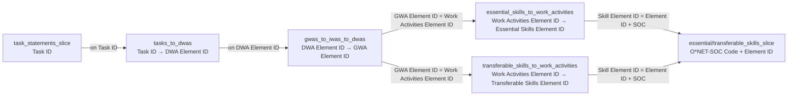

# Day 1–2 Execution Plan (through Call #1)

**Project root:** `/Users/yanzhou/Desktop/NYU/OntologyThesis`  
**Layout:** runbook-shaped (`data/raw`, `data/interim`, `data/processed`, `scripts`, `notebooks`, `docs`, `ontology`). Relocate existing ESCO + crosswalks into `data/raw/`.  
**Scope end:** after evidence for Call #1 is in `docs/crosswalk.md` with Confidence/Notes decision cells blank. No schema/OWL/RDF/populate.  
**Gate rule:** after each numbered task below, STOP and wait for your confirmation before the next.

This file is the approved Day 1–2 execution plan (through Call #1).

---

## Reality vs runbook (flags — carry into work)

| Issue | Severity | Implication |
|---|---|---|
| `data/raw/` missing; **zero O\*NET files on disk** | Blocker for Day 2 | Day 1 must download all 30.3 CSVs before any join |
| Runbook §2.2 join keys stale (`DWA ID`, `Element ID`, `Work Activity Element ID`) | Blocker if followed blindly | Use verified 30.3 names below |
| `tools_used.csv` under `db_30_2_csv/` is **404** | Day 1 note wrong | Extract `Tools Used.txt` from `db_30_2_text.zip` (tab-separated). Not needed for Call #1 |
| Crosswalk table says Data Scientists SOC 2010 = *none* | Stale/oversimplified | `soc_2010_to_2018_crosswalk.xlsx` maps **15-2099 → 15-2051**. Still a residual category; ISCO home remains weak |
| Runbook path `~/onet-ontology` | Ignore | Stay in this workspace |
| No git, no venv, no pandas | Expected | Task 0 sets this up |
| ESCO already present at root (spaced folder name) | OK | Move into `data/raw/esco/` |
| `conceptSchemes_en.csv` needs raised CSV field-size limit | Minor | Not required for Day 1–2 |

### Verified O\*NET 30.3 join keys (from remote headers — re-confirm after download in Task 2)

**Do not invent alternate keys.** If post-download inventory differs from these names, stop and report — do not substitute lookalikes.

---

## Task 0 — Repo layout + env (Day 1.1)

**Produces:** directory tree; `.git`; `.venv`; installed deps; `.gitignore`; this plan file already at `docs/day1-2_plan.md`.

**Reads:** nothing from data.

**Steps:**
1. Create `data/raw`, `data/interim`, `data/processed`, `ontology`, `scripts`, `notebooks`, `docs` (if missing).
2. `git init` in project root.
3. `python3 -m venv .venv && source .venv/bin/activate`
4. `pip install pandas openpyxl xlrd owlready2 rdflib requests` (`xlrd` needed for `.xls` crosswalk; runbook omitted it).
5. `.gitignore`: `.venv/`, `data/raw/`, `__pycache__/`, plus large local artifacts not in runbook (`*.rdf` bulk dumps, `*.zip`, `.DS_Store`, Office lockfiles).

**Could go wrong:** Python/pip path issues on macOS; `xlrd` version vs old `.xls`.

**Eyeball:** `ls` shows dirs; `which python` → `.venv`; `python -c "import pandas, openpyxl, xlrd"` succeeds; `git status` works.

**STOP — wait for confirmation.**

---

## Task 1 — Relocate existing ESCO + crosswalks into `data/raw/`

**Produces:**
- `data/raw/esco/` — contents of current `ESCO dataset - v1.2.1 - classification - en - csv/`
- `data/raw/ISCO_SOC_Crosswalk.xls`
- `data/raw/soc_2010_to_2018_crosswalk.xlsx`

**Reads / moves:** the three existing locations at repo root (and the ESCO folder).

**Join keys:** none.

**Could go wrong:** accidental delete; incomplete move; spaced folder name mishandled in shell.

**Eyeball:** `data/raw/esco/occupations_en.csv` exists; spot-check row count 3,043; crosswalks present under `data/raw/`; root no longer holds the moved copies (zips/RDF may remain gitignored at root or also moved — prefer leave zips/RDF at root gitignored, only move what Day 1–2 needs).

**STOP — wait for confirmation.**

---

## Task 2 — Download O\*NET 30.3 (+ frozen Tools from 30.2 text zip) + migration reference

**Produces:** CSVs under `data/raw/` matching runbook §1.2 list (all HTTP 200 verified), plus:
- `data/raw/Tools Used.txt` extracted from `https://www.onetcenter.org/dl_files/database/db_30_2_text.zip` (runbook CSV path is impossible)
- `data/raw/30_3_migration_reference.xlsx`

**Reads:** remote O\*NET URLs only.

**Join keys:** none yet.

**Could go wrong:** partial download; network flake; Tools extract wrong member path (`db_30_2_text/Tools Used.txt`).

**Eyeball:** every expected filename present; `Tools Used.txt` header is tab-separated `O*NET-SOC Code`, `Example`, `Commodity Code`, `Commodity Title`; linkage files non-empty (~110 / ~122 / ~381 skill↔WA rows).

**Note:** Tools file is acquired for completeness/thesis evidence but **not used** before Call #1.

**STOP — wait for confirmation.**

---

## Task 3 — Column inventory (Day 1.5)

**Produces:** [`scripts/00_inspect.py`](scripts/00_inspect.py), [`docs/column_inventory.txt`](docs/column_inventory.txt). Extend inspect to cover `data/raw/*.csv`, `data/raw/esco/*.csv`, and note Excel/TXT separately.

**Reads:** all files under `data/raw/` (and `data/raw/esco/`).

**Join keys:** none — this task *establishes* them.

**Could go wrong:** ESCO `conceptSchemes_en.csv` field-size error (raise limit or skip with explicit note); Excel not covered by naive `glob *.csv`.

**Eyeball (non-negotiable):** open inventory and confirm these exact names exist:
- `tasks_to_dwas`: `Task ID`, `DWA Element ID`
- `gwas_to_iwas_to_dwas`: `DWA Element ID`, `GWA Element ID`
- `essential_skills_to_work_activities`: `Work Activities Element ID`, `Essential Skills Element ID`
- occupation-level files: `O*NET-SOC Code`

If any expected key is absent → **flag and halt**; do not substitute.

**Day 1 done marker:** inventory exists and those three linkage files eyeballed.

**STOP — wait for confirmation.**

---

## Task 4 — Five-occupation slice (Day 2.1)

**Produces:** [`scripts/01_extract_slice.py`](scripts/01_extract_slice.py); `data/interim/*_slice.csv` for occupation-keyed files.

**Reads:** `data/raw/{occupation_data,task_statements,task_ratings,essential_skills,transferable_skills,knowledge,abilities,software_skills,work_activities,job_zones,sample_of_reported_titles,related_occupations}.csv`

**Filter set (exact O\*NET-SOC codes):**
- `15-1252.00` Software Developers
- `15-2051.00` Data Scientists
- `15-1254.00` Web Developers
- `15-1242.00` Database Administrators
- `15-1212.00` Information Security Analysts

**Join / filter key (verified remote header):** `O*NET-SOC Code` on every file in that list. Script may use the runbook’s `occ_col()` helper, but only accept a column that is literally the SOC code column from inventory — if missing, SKIP with message (do not guess `Related O*NET-SOC Code` as the filter key for the primary occupation).

**Could go wrong:** dtype inference turning codes into numbers; filtering `related_occupations` on primary SOC only (related codes outside the five are expected and kept as values); empty slice if codes wrong.

**Eyeball:** `occupation_data_slice.csv` has exactly 5 rows; each other slice has rows for all five codes (or documented gap); print value counts of `O*NET-SOC Code` per slice file.

**STOP — wait for confirmation.**

---

## Task 5 — Task→DWA→GWA→Skill chain + provenance + importance attach (Day 2.2)

**Produces:** [`scripts/02_task_skill_chain.py`](scripts/02_task_skill_chain.py); [`data/processed/task_skill_derived.csv`](data/processed/task_skill_derived.csv); a short [`docs/task_skill_gaps.md`](docs/task_skill_gaps.md) counting nulls at each hop (missing = null + reported, never imputed).

**Reads:**
- `data/interim/task_statements_slice.csv`
- `data/raw/tasks_to_dwas.csv`
- `data/raw/gwas_to_iwas_to_dwas.csv`
- `data/raw/essential_skills_to_work_activities.csv`
- `data/raw/transferable_skills_to_work_activities.csv`
- `data/interim/essential_skills_slice.csv`
- `data/interim/transferable_skills_slice.csv`
- (optional labels) `data/raw/content_model_reference.csv`

**Exact joins (from verified headers; re-check vs Task 3 inventory before running):**

| Step | Left | Right | Key(s) | how |
|---|---|---|---|---|
| 1 | task slice | `tasks_to_dwas` | `Task ID` | left |
| 2 | result | `gwas_to_iwas_to_dwas` | `DWA Element ID` | left |
| 3a | result | essential WA links | `GWA Element ID` = `Work Activities Element ID` | left |
| 3b | result | transferable WA links | same | left |
| 4 | concat 3a/3b with `skill_kind` ∈ {essential, transferable} | skill ratings slice | `O*NET-SOC Code` + skill element id → `Element ID` | left |

Skill element id column after concat: map `Essential Skills Element ID` / `Transferable Skills Element ID` into a single provenance-friendly `Skill Element ID` **by renaming from source columns**, not by looking up synonyms.

**Provenance columns (required on every output row):** at minimum  
`data_source`, `source_version` (`O*NET 30.3`), `derivation` (literal chain description), `skill_kind`, hop ids (`Task ID`, `DWA Element ID`, `IWA Element ID`, `GWA Element ID`, `Skill Element ID`), plus rating fields when present (`Scale ID`, `Data Value` for Importance/Level — only from matched rating rows; else null).  
Confidence scoring formula cells can be computed later; for this task attach raw importance when the join hits, else null — **no imputation**.

**Could go wrong:** cartesian blow-up if keys non-unique; joining WA links on DWA instead of GWA; conflating O\*NET essential/transferable with ESCO essential/optional; silently dropping nulls with inner joins.

**Eyeball:**
- Row count ≫ task count (multi-hop fan-out expected)
- Spot-check 10 rows: every non-null skill has non-null `Task ID` → `DWA Element ID` → `GWA Element ID` → `Skill Element ID` all filled from source
- Gap report: % tasks with no DWA; % DWA with no GWA; % GWA with no skill link; % structural edges with no occupation importance rating
- Head sample of `O*NET-SOC Code`, `Task`, skill name, `skill_kind`, importance

**STOP — wait for confirmation.**

---

## Task 6 — Crosswalk evidence pack + Call #1 stop (Day 2.3)

**Produces:** [`docs/crosswalk.md`](docs/crosswalk.md) — table filled with **evidence only**; **Cardinality / Confidence / your chosen ESCO URI decision left blank for you** where judgment is required. Also a small evidence appendix (quotes from files / row excerpts), not an automated mapper.

**Reads (no LLM inference of mappings):**
- `data/raw/soc_2010_to_2018_crosswalk.xlsx` — keys: `2018 SOC Code` ↔ `2010 SOC Code` (header at Excel row 9; codes without `.00` suffix)
- `data/raw/ISCO_SOC_Crosswalk.xls` — use sheet `2010 SOC to ISCO-08` (confirm sheet name after `xlrd` open); join key is **2010 SOC** (e.g. `15-1132`), not 2018
- `data/raw/esco/occupations_en.csv` — keys: `preferredLabel` / `altLabels` for candidate discovery; `conceptUri`, `iscoGroup`, `code` for recording candidates

**Evidence already verified offline (seed the table; you still decide):**

| O\*NET-SOC 2018 | SOC 2010 (from xlsx) | ISCO candidates (from runbook + ESCO/ISCO file — confirm in xls) | ESCO candidate(s) found locally | Your cells |
|---|---|---|---|---|
| 15-1252.00 Software Developers | 15-1132 + 15-1133 | 2512 (verify in xls) | `software developer` → `.../f2b15a0e-...` isco 2512 | Cardinality / Confidence / Notes **blank for you** |
| 15-1254.00 Web Developers | 15-1134 | 2513 | `web developer` → `.../c40a2919-...` isco 2513 | blank |
| 15-1242.00 Database Administrators | 15-1141 | 2521 | `database administrator` → `.../8c57af09-...` isco 2521 | blank |
| 15-1212.00 Information Security Analysts | 15-1122 | 2529 vs 2523 / ESCO ICT security\* | multiple ICT security\* under 2529; technician 3512 | blank |
| 15-2051.00 Data Scientists | **15-2099** (residual; runbook “none” is wrong) | no clean ISCO; ESCO files under **2511** | exact label `data scientist` → `http://data.europa.eu/esco/occupation/258e46f9-0075-4a2e-adae-1ff0477e0f30` (`iscoGroup=2511`, `code=2511.4`) | **Call #1 — blank** |

**Does not produce:** a chosen mapping for Data Scientists. Options (a)/(b)/(c) listed in runbook; recommendation noted as runbook’s, not selected.

**Could go wrong:** matching 2018 codes directly into ISCO×SOC 2010 file; picking ESCO URI by fuzzy “close enough” title; filling Confidence for you.

**Eyeball:** every row has file+cell provenance for SOC 2010 and listed ISCO/ESCO candidates; Data Scientists row documents 15-2099 + ESCO 2511.4 URI as *candidates*; Confidence empty; Call #1 explicitly awaiting you.

**Day 2 done marker for this scope:** `task_skill_derived.csv` exists (Task 5) and `docs/crosswalk.md` evidence is ready for your Call #1 decision.

**STOP — do not proceed to Day 3.**

---

## Explicitly out of scope (do not plan/execute)

- Protégé schema, OWL/TTL, `scripts/03_populate.py`, reasoner, CQ validation
- Fabricating task→skill edges
- Auto-resolving Call #1
- Chaining tasks without your confirmation

---

## Suggested confirmation checklist (you reply after each task)

After each task: “looks good, proceed” or “fix X then stop again.”
